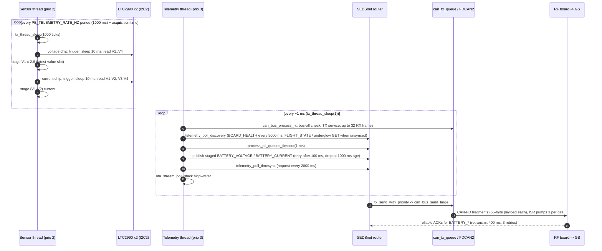

# Power board data pipeline

This document describes how PowerBoard26 (SEDSnet sender `PB`) measures the
avionics-bay battery, what it publishes, how the data leaves the board over
CAN, and where it ends up on the GroundStation. All numbers come from the
code at the commit this file was added in; each one cites its source. Where
comments, README or older docs disagree with the code, the code is taken as
true and the disagreement is listed in [Known gaps / bugs found](#known-gaps--bugs-found).

Scope summary:

- Two LTC2990 monitors on I2C2: one for voltage, one for current
  (`Core/Inc/ltc2990.h`, `Core/Src/ltc2990.c`).
- One network interface: FDCAN2, CAN-FD without bit-rate switching, into the
  avionics CAN network (`Core/Src/main.c` `MX_FDCAN2_Init`).
- No SD card, no ADC DMA, no radio. Everything the board measures is either
  sent over SEDSnet or lost.
- No load/rail power switching in firmware. The only switched output is the
  underglow pin (`BLUE_LED_Pin`, PB9), driven from the `AV_BAY_UNDERGLOW`
  network variable (`Core/Src/av_bay_underglow.c:47-52`). Rails are not
  measured individually; only battery voltage and battery current are.

## 1. Data path

```mermaid
flowchart LR
    subgraph HW["Power board hardware"]
        BAT["AV-bay battery"]
        LV["LTC2990 0x4C<br/>VOLTAGE role<br/>V1..V4 single-ended"]
        LI["LTC2990 0x4D<br/>CURRENT role<br/>V1-V2, V3-V4 differential<br/>5 mOhm shunt"]
        TS["MCU die temp + VREFINT<br/>ADC1, polled"]
    end

    subgraph SENS["Sensor thread, prio 2"]
        STEP["LTC2990_Step<br/>trigger, 10 ms, poll status<br/>blocking HAL I2C, 50 ms timeout"]
        CAL["V = V1 x 2.8<br/>I = code x 19.42 uV / (5 mOhm x 10k/81.5k)"]
        SLOT["Latest-value slot<br/>1 per channel + sample time"]
    end

    subgraph NET["Telemetry thread, prio 3, ~1 ms loop"]
        PUB["telemetry_ltc2990_publish_pending<br/>max age 1000 ms, retry 100 ms"]
        HL["board_health_poll<br/>every 5000 ms"]
        RT["SEDSnet router<br/>queue budget 8192 B"]
        ARB["board_can_arbitration_id<br/>0x002 / 0x082 / 0x102"]
        CQ["can_tx_queue<br/>6144 B, 48 packets, 1000 ms age"]
    end

    subgraph ISR["FDCAN2 ISRs, NVIC 6"]
        PUMP["TX pump<br/>3 frames per call"]
        RXR["RX ring 64 frames<br/>drop oldest"]
    end

    BAT --> LV
    BAT --> LI
    LV -->|I2C2 ~100 kHz| STEP
    LI -->|I2C2 ~100 kHz| STEP
    STEP --> CAL --> SLOT --> PUB
    TS --> HL
    PUB -->|BATTERY_VOLTAGE<br/>BATTERY_CURRENT| RT
    HL -->|BOARD_HEALTH| RT
    RT --> ARB --> CQ --> PUMP
    PUMP -->|CAN-FD 1 Mbit/s| CANBUS["Avionics CAN bus"]
    CANBUS --> RXR --> RT
    CANBUS --> RF["RF board<br/>CAN to RFD900 relay"]
    RF -->|radio| GS["GroundStation backend<br/>SEDSnet decode"]
    GS --> DB["Rolling SQLite ring<br/>+ event captures"]
    RF -.->|radio| RRLS["RRLS<br/>own ring"]
```

There is no on-board storage of measurements. The board's LaunchCore
persistent store holds only configuration state (cached `FLIGHT_STATE`,
underglow value, boot identity, recovery floor, commissioning record;
`README.md`, `Core/Src/flight_state_cache.c`, `Core/Src/av_bay_underglow.c`).

### Hardware and bus parameters

| Item | Value | Source |
| --- | --- | --- |
| SYSCLK / PCLK1 | 170 MHz (HSI 16 MHz / 4 x 85 / 2) | `Core/Src/main.c` `SystemClock_Config` |
| FDCAN2 clock | PCLK1 | `Core/Src/stm32g4xx_hal_msp.c:102` |
| CAN nominal bit rate | 1 Mbit/s (170 MHz / (10 x (1+13+3))) | `main.c` `NominalPrescaler = 10`, `NominalTimeSeg1 = 13`, `NominalTimeSeg2 = 3` |
| CAN frame format | `FDCAN_FRAME_FD_NO_BRS`, auto-retransmission on | `main.c` `MX_FDCAN2_Init` |
| CAN acceptance | accept all standard and extended IDs into RX FIFO0 | `can_bus.c` `can_bus_config_accept_all` |
| I2C2 clock source | PCLK1, timing `0x40B285C2` (about 100 kHz at 170 MHz) | `stm32g4xx_hal_msp.c:187`, `main.c` `MX_I2C2_Init` |
| LTC2990 addresses | voltage `0x4C`, current `0x4D` | `ltc2990.h` `LTC2990_I2C_ADDRESS_VOLTAGE`, `LTC2990_I2C_ADDRESS_CURRENT` |
| I2C transaction timeout | 50 ms | `ltc2990.h` `LTC2990_I2C_TIMEOUT_MS` |
| Data-ready deadline per channel | 250 ms | `ltc2990.h` `LTC2990_DATA_READY_TIMEOUT_MS` |
| ThreadX tick | 1000 Hz | `Core/Inc/tx_user.h` `TX_TIMER_TICKS_PER_SECOND`; SysTick reload `SYSTEM_CLOCK/1000-1` in `tx_initialize_low_level.S` |

## 2. Schedule

The sensor loop is not fixed-rate: it sleeps one full period and then runs
two LTC2990 steps (`Core/Src/sensor_thread.c:72-77`), so the real period is
1000 ms plus at least 2 x 10 ms of conversion wait plus I2C time
(`Core/Src/ltc2990.c:89-134`). In the worst case (every status poll hitting the
250 ms deadline) one cycle can stretch by about 1.5 s; the watchdog overdue
limit is 8000 ms (`Core/Src/board_watchdog.c` `BOARD_WATCHDOG_OVERDUE_MS`).

## 3. Threads, timers, ISRs, DMA

| Context | Priority | Period / trigger | What it does | Source |
| --- | --- | --- | --- | --- |
| Sensor thread | ThreadX 2, preempt threshold 2, 3 KiB stack | sleep `SENSOR_LOG_PERIOD_TICKS` = 1000 ticks, then two LTC2990 steps | Init both LTC2990s (retries every 1 s until present), then acquire voltage and current, stage into latest-value slots, check in `BOARD_WATCHDOG_ACQUISITION` | `Core/Src/sensor_thread.c:16,19,54-77,105-106`; `Core/Inc/telemetry_rate.h:9` |
| Telemetry thread | ThreadX 3, preempt threshold 3, 15 KiB stack | loop with `tx_thread_sleep(1)` (1 ms) | CAN RX drain and reassembly, discovery, `BOARD_HEALTH`, router RX/TX queues (1 ms budget), sensor publication, time sync, OTA stream, stack profiling, check in `BOARD_WATCHDOG_NETWORK` | `Core/Src/telemetry_thread.c:17-18,43-89,109-110` |
| USBX device thread | ThreadX 10 | USB events | CDC-ACM device stack (debug only, carries no telemetry) | `USBX/App/app_usbx_device.h:48` |
| ThreadX timer / SysTick | Cortex-M exception | 1 kHz | Scheduler tick | `Core/Inc/tx_user.h:240`, `tx_initialize_low_level.S` |
| TIM1 update (HAL timebase) | NVIC 15 (`TICK_INT_PRIORITY`) | 1 kHz | `HAL_IncTick` (used by `HAL_GetTick`, CAN queue ageing, board uptime) | `Core/Src/stm32g4xx_hal_timebase_tim.c:90`, `Core/Inc/stm32g4xx_hal_conf.h:184` |
| FDCAN2 IT0 / IT1 | NVIC 6 | RX FIFO0/1 new message | Copy up to 3 frames from the hardware FIFO into the 64-frame software ring, with a 24-bit microsecond receive stamp | `stm32g4xx_hal_msp.c:124-126`; `can_bus.c:1068-1087` |
| FDCAN2 TX complete / TX FIFO empty | NVIC 6 | hardware TX buffer done | `can_tx_queue_pump` (up to 3 fragments), time-sync TX stamp | `can_bus.c:987-995`; `can_tx_queue.c:102-136` |
| USB_LP | NVIC 5 | USB | USB FS PCD | `stm32g4xx_hal_msp.c:350` |
| IWDG | independent LSI | ~16.384 s deadline (/256, reload 2047) | Fed only when both required workers (network, acquisition) checked in and at least 250 ms since last feed | `Core/Src/board_watchdog.c` `board_watchdog_start`, `board_watchdog_progress` |
| DMA | none | n/a | I2C, ADC and CAN are all CPU-driven (blocking HAL I2C, polled ADC, FDCAN message RAM) | `ltc2990.c:219-239`, `board_temperature.c:73-82` |

USART2 is initialised by CubeMX (`main.c` `MX_USART2_UART_Init`) but no code
reads or writes it.

## 4. Streams

### 4.1 Measured and published streams

| Stream | `BATTERY_VOLTAGE` | `BATTERY_CURRENT` | `BOARD_HEALTH` |
| --- | --- | --- | --- |
| Source | LTC2990 `0x4C`, V1 single-ended | LTC2990 `0x4D`, V1-V2 differential across 5 mOhm shunt | Board counters, MCU die temperature (ADC1 temp sensor + VREFINT) |
| Sample rate | 1 Hz nominal (`PB_TELEMETRY_RATE_HZ 1.0`, `telemetry_rate.h:9`), effective period 1000 ms + acquisition | same cycle, read right after voltage | die temp sampled at most every 5000 ms (`board_temperature.c:16`) |
| Read | Trigger, 10 ms, poll status bit until set or 250 ms, read MSB/LSB, require data-valid bit (`ltc2990.c:89-110,171-198`) | Same, channels V1-V2 and V3-V4 (`ltc2990.c:111-133`) | Polled ADC, 640.5-cycle sampling, 12-bit (`board_temperature.c:60-63`) |
| Filtering | None on board. A failed or invalid read publishes `NaN` (`ltc2990.c:107-108`) | None; V3-V4 is measured and then discarded (`ltc2990.c:122-127`) | None |
| Units / calibration | Volts. `code14 x 5 V / 16384` (`ltc2990.h` `SINGLE_ENDED_LSB`) x `2.8` divider factor (literal in `ltc2990.c:284`) | Amperes, positive = battery draw. `code15 (two's complement) x 19.42 uV / (RSENSE_OHM 0.005 x CURRENT_DIVIDER_RATIO 10000/81500)` = about 31.65 mA/count (`ltc2990.c:207-216`, `ltc2990.h:35-40`) | 24 x UInt32, little-endian. Temp: centi-degC in word 1 bits 16..31, valid bit 8, age in 100 ms units in bits 9..15 (`board_temperature_math.h:22-27`) |
| Board staging | One latest-value slot per channel; a newer sample overwrites an unsent one (`ltc2990.c:251-275,297-299`) | same | built on the stack when due (`board_health.c:32`) |
| Publish rate | once per accepted sample, ~1 Hz | ~1 Hz | every 5000 ms of HAL uptime (`board_health.c:28`) |
| Publish retry / freshness | Failed admission retried every 100 ms (`SENSOR_PUBLISH_RETRY_MS`), sample retired once 1000 ms old (`SENSOR_PUBLISH_MAX_AGE_MS`) (`ltc2990.c:258-259,315-337`) | same, per channel | no retry; a refused report increments word 23 (`board_health.c:52,68`) |
| Timestamp | Acquisition time mapped to network UTC (`now_unix - age`); router-relative ms before time sync (`telemetry.c` `log_telemetry_asynchronous_at_locked`) | same | SDK default (time of logging) |
| SD save | none (board has no SD) | none | none |
| SEDSnet type | `BATTERY_VOLTAGE`, Float32 x 1 (`config/sedsnet.json`) | `BATTERY_CURRENT`, Float32 x 1 | `BOARD_HEALTH`, UInt32 x 24 |
| Endpoints | `GROUND_STATION`, `SD_CARD` | `GROUND_STATION`, `SD_CARD` | `GROUND_STATION` |
| Reliability | `Unordered` reliable; retransmit 400 ms, 3 retries (`telemetry.c:697-698`) | same | `Off` (best effort) |
| SEDSnet priority | 0 | 0 | 0 |
| CAN arbitration ID | `0x102` (data band) | `0x102` | `0x102` |
| CAN queue class | data: at most 36 packets and 4608 B of the 48 / 6144 B queue (`can_tx_queue.c:70-77`) | same | same |
| On-board latency | sample -> publish: next telemetry loop, about 1 ms; publish -> CAN: router queue service (1 ms budget per loop) then FIFO order in the data band | same | same |
| Buffer depth / drop policy | 1 slot (overwrite); router queue 8192 B (`CMakeLists.txt` `SEDSNET_MAX_QUEUE_BUDGET`); CAN queue entries expire after 1000 ms (`CAN_TX_MAX_AGE_MS`), new data is refused with `HAL_BUSY` when the class limit is hit | same | same |

Whole-network path after CAN: the RF board relays every type addressed to
`GROUND_STATION` over the RFD900 link; its scheduling, airtime budget and
priority classes are described in `RFBoard26/docs/data-pipeline.md`. With
SEDSnet priority 0, PB data is in the lowest class there.

### 4.2 Network traffic the board consumes or originates for control

| Traffic | Direction | Rate | Source |
| --- | --- | --- | --- |
| `FLIGHT_STATE` (network variable, Ordered, prio 16) | GS -> PB, cached in flash | GET while unsynced: 500 ms backing off to 4000 ms | `Core/Src/flight_state_cache.c:21-25` |
| `AV_BAY_UNDERGLOW` (network variable, Unordered, prio 16) | GS -> PB, drives PB9 | GET every 500 ms while unsynced, no backoff; flash write after 2000 ms settle, at most once per 60000 ms | `Core/Src/av_bay_underglow.c:13,18,21,141-152` |
| Time sync (consumer, `TELEMETRY_TIMESYNC_MASTER_PRIO -1`) | PB <-> source | request/announce interval 2000 ms, source timeout 5000 ms | `CMakeLists.txt`; `telemetry.c:56-66` |
| Discovery schema announcement | PB -> network | once after start, retried every 1000 ms until accepted | `telemetry.c` `telemetry_poll_discovery_locked` |
| Board recovery query (`BOARD_RECOVERY_PB`) | GS <-> PB | on request | `telemetry.c` `Board_Recovery_handler` |
| OTA stream | GS -> PB | on request | `Core/Src/ota_stream.c` |

### 4.3 CAN transmit queue

| Parameter | Value | Source |
| --- | --- | --- |
| Byte budget | 6144 B (including per-packet header and 16 B allocator charge) | `can_tx_queue.c:7,63-66` |
| Max packets | 48 | `CAN_TX_MAX_PENDING` |
| Max packet | 128 B | `CAN_TX_MAX_PACKET` |
| Max age | 1000 ms, then dropped (counted in `g_can_tx_expired`) | `CAN_TX_MAX_AGE_MS`, `can_tx_queue.c:105-108` |
| Fragment payload | 55 B; multi-fragment packets use full 64 B frames | `can_tx_queue.h` `CAN_TX_FRAGMENT_PAYLOAD_BYTES`, `can_tx_queue.c:123` |
| Class reserve | urgent (`id < 0x80`): full queue; metadata (`< 0x100`): -4 packets, -512 B; data: -12 packets, -1536 B | `can_tx_queue.c:70-77` |
| Ordering | urgent packets are inserted after other urgent packets but ahead of all others; rest FIFO | `can_tx_queue.c:182-191` |
| Arbitration bands | `0x002` priority >= 200 or `HEARTBEAT`; `0x082` discovery schema (type 10) or priority >= 200 SDT bulk; `0x102` everything else | `Core/Inc/board_can_priority.h:89-101`, `telemetry.c` `tx_send_with_priority` |

### 4.4 CAN receive path

| Parameter | Value | Source |
| --- | --- | --- |
| ISR copy per interrupt | up to 3 frames | `can_bus.c:1076,1087` |
| Software ring | 64 frames, drop-oldest; drops counted and reported in `BOARD_HEALTH` word 12 | `can_bus.c:351,450-470` |
| Thread service | up to 32 frames per loop | `CAN_BUS_RX_SERVICE_BUDGET`, `can_bus.c:1050` |
| Reassembly | 4 slots, 2048 B, 64 fragments, 1000 ms timeout; when full the stalest slot is evicted | `can_bus.c:544-552,327,600-635,657-668` |
| Bus-off recovery | retried every 100 ms; aborts hardware TX buffers and empties the TX queue | `can_bus.c:236,281,291` |

## 5. BOARD_HEALTH word map

| Word | Content | Source |
| --- | --- | --- |
| 0 | `1` | `board_health.c:32` |
| 1 | `2`, bit 0 = TLSF build, die temperature fields (see 4.1) | `board_health.c:32,43,51` |
| 2, 3 | HAL uptime ticks, low/high | `board_health.c:32` |
| 4 | uptime frequency, 1000 Hz | `board_uptime.h:6` |
| 5 | reset flags (RCC CSR at boot) | `board_health.c:34` |
| 6 | bits 0..15 overdue watchdog tasks, 16..23 failed optional services, 24..31 time-sync health byte | `board_health.c:38-39,57` |
| 7..10 | TLSF live, peak, region bytes, failures | `board_health.c:44-45` |
| 11 | SDK memory admission rejections | `board_health.c:49` |
| 12 | CAN RX ring drops | `board_health.c:47` |
| 22 | `"SY"` tag, time-sync stratum (bits 8..15), health byte | `board_health.c:60` |
| 23 | refused or lock-failed `BOARD_HEALTH` reports | `board_health.c:50` |

## 6. Where the data ends up on the GroundStation

Paths below refer to the GroundStation26 repository.

| Stream | GS decoding / use | Recorded by the GS | Saved on PB |
| --- | --- | --- | --- |
| `BATTERY_VOLTAGE` (`PB`) | Generic numeric row; shown under "Battery Voltage / AV Bay" with an 8 Hz display-only low-pass (`backend/layout/layout.json` `battery_voltage_pb`). Range alarm from the layout battery source `av_bay`: 6.3..8.4 V (`layout.json` `battery.sources`, `backend/src/safety_task.rs:142-188`). Feeds the battery estimator, 300 s window (`backend/src/telemetry_task/derived.rs:519`), producing `AV_BAY_BATTERY_PERCENT`, `AV_BAY_BATTERY_DROP_RATE_V_PER_MIN`, `AV_BAY_BATTERY_REMAINING_MINUTES` | One `telemetry` row per packet: GS receive time, source timestamp, values, raw payload (`backend/src/telemetry_task.rs:3346-3360`); derived battery rows recorded too (`derived.rs:562-578`) | nothing |
| `BATTERY_CURRENT` (`PB`) | Generic numeric row; "Battery Current / AV Bay" chart. Intended 0..50 A alarm, see gap G6 | One `telemetry` row per packet | nothing |
| `BOARD_HEALTH` (`PB`) | `network_health` decodes word 6 bits 24..31 and word 22 stratum for PB (`backend/src/network_health.rs:178-183`); other words feed board diagnostics | Raw payload only, `values_json = "[]"` (`backend/src/telemetry_task/recording_diagnostics.rs:117-145`) | nothing |
| `FLIGHT_STATE`, `AV_BAY_UNDERGLOW` | GS is the authority and pushes values; PB only consumes | GS records its own state | latest value in LaunchCore persistent store |

Recording on the GS (`docs/backend/rolling-recording.md`): every row goes
into the always-on rolling SQLite ring (`data/recordings/rolling/segment_*.db`,
64 MB segments, budget `min(50 GB, disk - 8 GB reserve)`). Event captures
(launch: 10 min pre-roll, 5 min post-roll; abort; fill and other sequences;
ground test; manual) are copies cut from that ring, so PB rows inside a
capture window are included automatically. Writes go through the DB work
queue (`GS_DB_WORK_QUEUE_SIZE`, default 8192, `backend/src/main.rs:1499`); on
a full queue the writer waits instead of dropping (`telemetry_task.rs:2324-2349`).
An RRLS records its own ring from what it receives.

There is no board-side copy to recover after a flight: if a PB packet did not
reach the GS (CAN queue expiry, radio scheduling, reliable retries
exhausted), it is gone. Board SD launch files (`irec_LAUNCH-*.csv`,
`DAQ_LAUNCH_*.CSV`) exist only for the FC and DAQ.

`BATTERY_*` are also addressed to `SD_CARD`, the DAQ's endpoint. The DAQ's
`SD_CARD` handler accepts and ignores every type except its own control types
(`DAQ-Board/Core/Src/telemetry.c:701,723-737`), so PB samples are not written
to the DAQ card either.

## Known gaps / bugs found

These were recorded in the audit. G2 was fixed in board-bugfix-20261123; the rest are unchanged.

- **G1 Rate: code vs comments/docs.** Code publishes at 1 Hz
  (`Core/Inc/telemetry_rate.h:9`, `PB_TELEMETRY_RATE_HZ 1.0`; also asserted by
  `tests/test_telemetry_rate.py:10`). Stale statements of a 5 s / 0.2 Hz
  cadence remain in `Core/Src/sensor_thread.c:17-18`, `Core/Src/ltc2990.c:256-257`,
  `Core/Src/board_watchdog.c` (comment above `BOARD_WATCHDOG_OVERDUE_MS`),
  `README.md` ("five-second source cadence") and
  `docs/sensor-publication-retry-2026-10-26.json` (`sampling_interval_ms: 5000`).
  The README's "default 1 Hz" sentence matches the code.
- **G2 (fixed, board-bugfix-20261123).** Every path that loses the watched
  packet now returns `watch_state` to 0: expiry or reset while queued, the
  bus-off reset of a hardware buffer, a refused or oversize submit, a send
  refused before the queue (`can_tx_queue_watch_disarm()`), and a completion
  that never arrives (abandoned after `CAN_TX_MAX_AGE_MS`). The fix is the
  same in RFBoard26 and gateway-board26; `tests/test_can_tx_queue.py` covers
  each path. Original finding: **Time-sync TX stamp watch can latch forever (bug).** In
  `Core/Src/can_tx_queue.c`, `can_tx_queue_watch_next()` (line 37) refuses to
  arm while `watch_state` is 2 or 3. State 2 is cleared only when the watched
  packet's last fragment is submitted (lines 127-129); state 3 only by
  `can_tx_queue_note_complete()` (lines 39-43). A watched packet that expires
  in `can_tx_queue_pump()` (lines 105-108) or is discarded by
  `can_tx_queue_reset()` (lines 200-205, called from bus-off recovery at
  `can_bus.c:291` after `HAL_FDCAN_AbortTxRequest` at `can_bus.c:281`) never
  resets `watch_state`. After that, `seds_router_note_frame_sent()` in
  `telemetry_poll_timesync_locked` is never called again until reboot, so time
  sync loses its precise transmit stamps. Separately, if `can_tx_queue_submit`
  returns `HAL_BUSY` after state 1 was armed, the next unrelated packet is
  watched instead (lines 153-181). The same file is present in RFBoard26 and
  gateway-board26.
- **G3 Voltage scale is an unnamed literal.** `stage_sensor_report(1U, voltages[0] * 2.8f)`
  (`Core/Src/ltc2990.c:284`) has no named constant or divider comment, unlike
  the current path (`ltc2990.h:37-40`). The value could not be checked against
  the schematic from this repository.
- **G4 Only V1 and V1-V2 are used.** The voltage chip converts V1..V4 and the
  current chip converts V3-V4, but only V1 and V1-V2 are published
  (`ltc2990.c:94-133,284,293`). The extra conversions cost I2C time every cycle.
- **G5 NaN is published on a failed read.** A failed status poll or invalid
  data bit sets `NaN` (`ltc2990.c:107-108`) and that value is staged and sent.
  The GS ignores non-finite values in the range check (`safety_task.rs:210`),
  so a dead sensor shows as gaps rather than an alarm.
- **G6 GS current alarm reads the wrong element (GS bug).**
  `GroundStation26/backend/src/safety_task.rs:656-663` checks
  `values.get(1)` for `BATTERY_CURRENT`, but the type is Float32 x 1
  (`backend/config/telemetry_config.json:158-165`). `get(1)` is always `None`,
  so the 0..50 A alarm never fires for PB (or any sender).
- **G7 Underglow GET has no backoff.** While unsynced, PB requests
  `AV_BAY_UNDERGLOW` every 500 ms indefinitely (`av_bay_underglow.c:141-152`),
  whereas `FLIGHT_STATE` backs off to 4000 ms because an unanswered GET would
  otherwise repeat at 2 Hz on the radio (`flight_state_cache.c:22-25`).
- **G8 32-bit millisecond clock.** `tx_raw_now_ms_locked()` converts a 32-bit
  `tx_time_get()` value (`telemetry.c:117-120`); at 1000 Hz it wraps after
  about 49.7 days of uptime, after which the router clock
  (`node_now_since_ms`) and the sample age checks in
  `telemetry_ltc2990_publish_pending` (`ltc2990.c:315,323`) go backwards.
  Not reachable in a normal campaign, listed for completeness.
- **G9 Acquisition period drifts.** The sensor loop sleeps a full period and
  then acquires (`sensor_thread.c:72-77`), so the sample interval is
  1000 ms plus acquisition time, not a fixed 1 Hz grid.
- **G10 Fixed (board-bugfix-20261123): the first LTC2990 blocked the second.**
  `sensor_thread.c` now tries each monitor once at startup and continues; a
  monitor that does not answer is retried in the acquisition loop on its own
  backoff (1, 2, 4, 8, 16 s, then every 32 s, `Core/Inc/power_monitor_retry.h`),
  and each answering monitor is sampled regardless of the other. `BOARD_HEALTH`
  words 16..19 (tag "LTC1", same layout as the gateway board) report the
  answering mask (bit 0 voltage, bit 1 current; clear = absent, not trusted),
  the longest retry delay in ms (0 healthy) and init retries since boot.
  `tests/test_power_monitor_startup.py` covers ten minutes with the voltage
  monitor absent (current sampled every period, 23 voltage probes instead of a
  blocking loop), pick-up when it appears, and the reverse case across the
  32-bit ms wrap. Original finding: if the voltage monitor never answered, the
  init loop at `sensor_thread.c:54-60` retried forever and the current monitor
  was never initialised, so neither stream was published.
